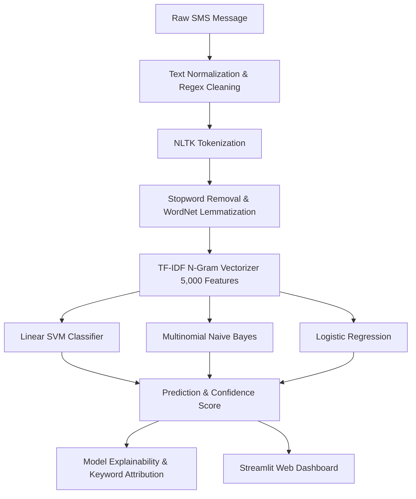

# 🛡️ SMS Spam Detection System (NLP)

[](https://www.python.org/)
[](https://scikit-learn.org/)
[](https://www.nltk.org/)
[](https://streamlit.io/)
[](https://opensource.org/licenses/MIT)

An end-to-end **Natural Language Processing (NLP)** and **Machine Learning** system designed to detect and classify SMS spam, phishing, and smishing messages. Built for academic presentation and real-world experimentation, featuring multiple classification algorithms, model explainability (keyword attribution), and an interactive Streamlit dashboard.

---

## 📌 Key Highlights

- **Dataset**: Trained on the benchmark [UCI Machine Learning Repository SMS Spam Collection](https://archive.ics.uci.edu/dataset/228/sms+spam+collection) (5,574 labeled messages).
- **Comprehensive NLP Pipeline**: Regex cleaning, tokenization (`nltk.word_tokenize`), stopword filtering, and morphological lemmatization (`WordNetLemmatizer`).
- **Feature Extraction**: TF-IDF vectorization with unigrams and bigrams across 5,000 features.
- **Multiple Classifiers**: Evaluated **Linear SVM**, **Multinomial Naive Bayes**, and **Logistic Regression**.
- **Model Explainability**: Feature attribution engine identifying which specific vocabulary tokens triggered the spam/ham classification.
- **Interactive Web App**: Multi-tab Streamlit dashboard with side-by-side model comparison, step-by-step NLP pipeline inspection, and benchmark charts.

---

## 🏆 Model Performance Benchmark

Evaluated on **1,115 stratified held-out test messages** (966 legitimate messages, 149 spam messages):

| Model Architecture | Accuracy | Precision | Recall | F1-Score | Key Strength |
| :--- | :---: | :---: | :---: | :---: | :--- |
| **Support Vector Machine (Linear SVM)** | **98.48%** | **97.83%** | **90.60%** | **0.9408** | **Highest overall accuracy & balanced F1** |
| **Multinomial Naive Bayes** | 97.04% | **100.00%** | 77.85% | 0.8755 | **Zero False Positives (100% Precision)** |
| **Logistic Regression** | 97.04% | **100.00%** | 77.85% | 0.8755 | Calibrated probabilistic confidence |

> **Why Precision Matters**: In spam detection, a *False Positive* means an important legitimate message (such as a 2FA OTP, bank alert, or medical reminder) is erroneously flagged as spam. Multinomial Naive Bayes achieved **100% precision with 0 false positives** on the test set.

---

## 🏗️ Architecture & Pipeline Flow



---

## 📁 Repository Structure

```
sms_spam/
├── data/                             # Dataset storage (auto-downloaded on first run)
│   └── spam.csv                      # UCI SMS dataset (5,574 messages)
├── models/                           # Serialized model artifacts & evaluation plots
│   ├── tfidf_vectorizer.pkl          # Fitted TF-IDF extractor
│   ├── svm_model.pkl                 # Trained Linear SVM model
│   ├── naive_bayes_model.pkl         # Trained MultinomialNB model
│   ├── logistic_regression_model.pkl # Trained LogisticRegression model
│   ├── model_comparison.png          # Grouped benchmark chart
│   └── *_confusion_matrix.png        # Individual confusion matrix heatmaps
├── notebooks/
│   ├── eda.py                        # Automated Exploratory Data Analysis generator
│   └── figures/                      # 8 high-resolution EDA figures
├── src/
│   ├── __init__.py                   # Package initializer
│   ├── data_loader.py                # UCI dataset downloader & stratified splitter
│   ├── preprocessor.py               # Text cleaning, regex, tokenization, lemmatization
│   ├── feature_extractor.py          # TF-IDF feature extraction module
│   ├── models.py                     # Scikit-learn model constructors & training
│   ├── lstm_model.py                 # Optional Keras/TensorFlow deep learning architecture
│   ├── evaluator.py                  # Metric computation, classification reports, plots
│   └── predict.py                    # Inference engine & keyword attribution
├── app.py                            # Interactive presentation-ready Streamlit web app
├── run_app.bat                       # One-click desktop launcher for Windows
├── train.py                          # End-to-end training pipeline script
├── PRESENTATION_GUIDE.md             # 3-minute presentation script & viva Q&A
├── requirements.txt                  # Pinned dependencies
├── LICENSE                           # MIT License
└── README.md                         # Documentation
```

---

## ⚡ Quick Start

### 1. Clone the Repository
```bash
git clone https://github.com/YOUR_USERNAME/sms-spam-detection.git
cd sms-spam-detection
```

### 2. Create and Activate Virtual Environment
```bash
# Windows
python -m venv venv
.\venv\Scripts\activate

# macOS / Linux
python3 -m venv venv
source venv/bin/activate
```

### 3. Install Dependencies
```bash
pip install -r requirements.txt
```

### 4. Launch the Interactive Web Dashboard
```bash
# Or double-click run_app.bat on Windows
streamlit run app.py
```
Open **`http://localhost:8501`** in your browser.

---

## 🧪 Training & Reproducibility

To re-run the full training pipeline, evaluate all models, and generate fresh confusion matrices:
```bash
python train.py
```

To regenerate all exploratory visualizations (word clouds, class distributions, length histograms):
```bash
python notebooks/eda.py
```

To run quick inference tests from the command line:
```bash
python src/predict.py
```

---

## 📊 Exploratory Data Analysis (EDA) Insights

1. **Class Distribution**: 4,825 legitimate messages (86.6%) vs. 747 spam messages (13.4%), reflecting real-world class imbalance.
2. **Message Length**: Spam messages average 140–160 characters (maximizing standard 160-character SMS constraints), whereas legitimate messages peak at 30–50 characters.
3. **Vocabulary Patterns**:
   - **Spam**: High frequency of urgency and monetary terms (`claim`, `prize`, `call`, `free`, `urgent`, `cash`).
   - **Ham**: Conversational terms (`go`, `come`, `time`, `know`, `love`, `ok`).

---

## 📜 Citation & Acknowledgements

- **Dataset**: [UCI Machine Learning Repository — SMS Spam Collection](https://archive.ics.uci.edu/dataset/228/sms+spam+collection) (Almeida, T. A., Hidalgo, J. M. G., & Yamakami, A.).
- **Libraries**: Scikit-Learn, NLTK, Streamlit, Matplotlib, Seaborn.

---

## 📄 License

This project is open-source under the [MIT License](LICENSE).
